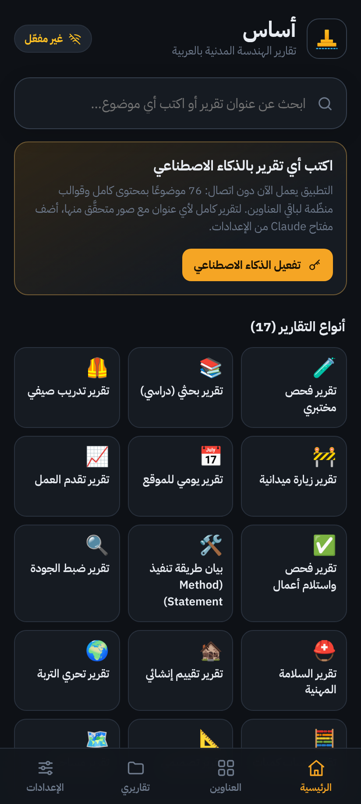
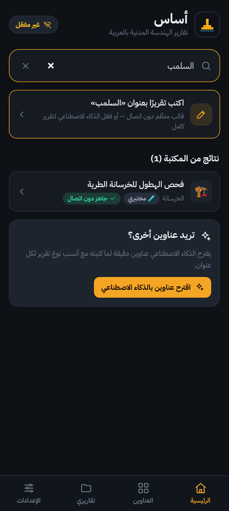
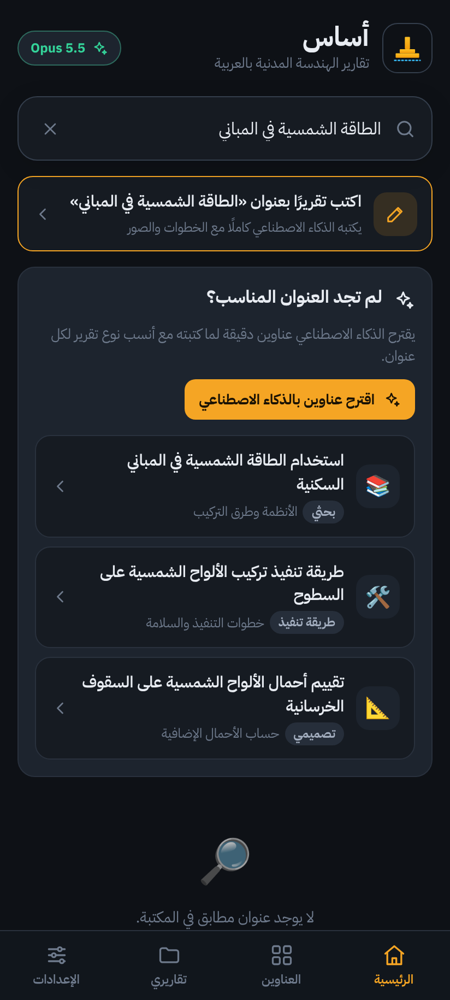
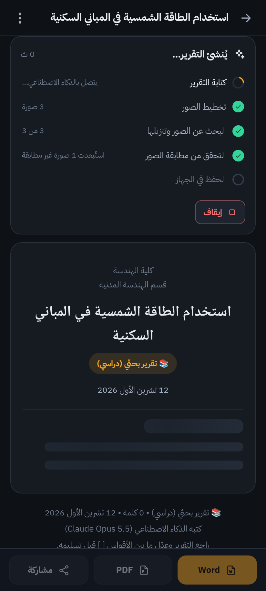
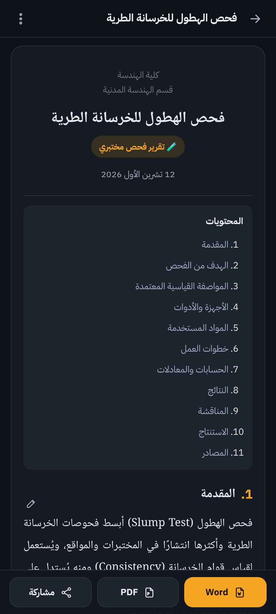
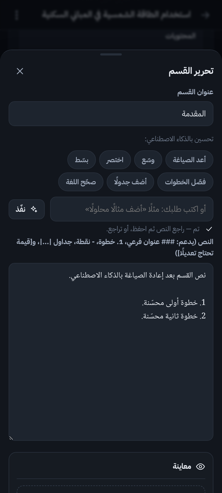

# أساس — تقارير الهندسة المدنية بالعربية

تطبيق أندرويد (ويعمل في المتصفح أيضًا) يكتب **تقارير الهندسة المدنية بالعربية مع الخطوات**،
بأكثر من ١٠ أنواع تقارير، ومكتبة عناوين فيها بحث، وكتابة بالذكاء الاصطناعي لأي عنوان،
وصور حقيقية من مواقع موثوقة **يتحقّق التطبيق منها قبل وضعها**، وتصدير إلى Word وPDF.

| | | |
|---|---|---|
|  |  |  |
|  |  |  |

---

## ما الذي فيه؟

| الميزة | التفاصيل |
|---|---|
| **١٧ نوع تقرير** | مختبري، بحثي (دراسي)، تدريب صيفي، زيارة ميدانية، يومي للموقع، تقدّم العمل، فحص واستلام أعمال، طريقة تنفيذ (Method Statement)، ضبط جودة، سلامة مهنية، تقييم إنشائي، تحرّي التربة، كميات وكلفة، تصميمي، مساحي، تحقيق في فشل أو حادث، مقترح بحث أو مشروع تخرج |
| **الخطوات في كل تقرير** | لكل نوع قسم خطوات مرقّمة: خطوات العمل في المختبر، تسلسل التنفيذ، خطوات الفحص، خطوات التصميم، طريقة الحساب… |
| **مكتبة ٣٢٣ عنوانًا** | في ١٦ قسمًا: الخرسانة، مواد البناء، التربة، الأسس، الحديد، الطرق والأسفلت، المساحة، تنفيذ المباني، التشطيبات، الموارد المائية، الصحية والبيئية، الجسور، التصميم الإنشائي، الفحص والصيانة، إدارة المشاريع، السلامة |
| **بحث ذكي بالعربية** | يتسامح مع الأخطاء الإملائية والهمزات والتاء المربوطة، ويفهم العامية العراقية: «سلمب»، «كونكريت»، «شيش»، «قير»، «لبخ»، «شدات»، «خوازيق»، «نزيز»، «ليفل»، «بروكتر»… |
| **لم تجد العنوان؟** | اكتب التقرير بعنوانك مباشرة، أو دع الذكاء الاصطناعي يقترح ٨ عناوين دقيقة مع أنسب نوع لكل منها |
| **الذكاء الاصطناعي** | Claude يكتب التقرير كاملًا ويظهر النص أثناء الكتابة، ويحرّر أي قسم (إعادة صياغة، توسيع، اختصار، تبسيط، تفصيل الخطوات، إضافة جدول، تصحيح اللغة، أو أي طلب تكتبه) |
| **صور دون أخطاء** | من ويكيبيديا وويكيميديا كومنز وOpenverse، كل صورة تُنزَّل ويُتحقّق من سلامتها، ثم **يراها الذكاء الاصطناعي ويرفض غير المطابقة**، وتُحفظ في جهازك مع مصدرها ورخصتها |
| **يعمل دون إنترنت** | ٧٦ موضوعًا بمحتوى هندسي كامل (أشهر فحوصات المختبرات وأعمال التنفيذ)، وقالب منظّم بإرشادات لأي عنوان آخر |
| **تصدير** | Word (.docx) باتجاه من اليمين لليسار مع غلاف وفهرس وصور وأرقام صفحات، وPDF بالطباعة، ومشاركة النص |

---

## التثبيت على التلفون

نزّل ملف `Asas.apk` من صفحة **Releases** في المستودع (الإصدار `asas-apk-latest`)،
افتحه من التلفون واسمح بالتثبيت من مصادر غير معروفة. يُبنى الملف تلقائيًا في GitHub Actions مع كل تحديث.

---

## تفعيل الذكاء الاصطناعي

1. ادخل [console.anthropic.com](https://console.anthropic.com) ← **API Keys** ← أنشئ مفتاحًا، واشحن رصيدًا بسيطًا.
2. في التطبيق: **الإعدادات ← الذكاء الاصطناعي ← مفتاح Claude API** ← الصق المفتاح ← «اختبار الاتصال».

المفتاح يُحفظ في جهازك فقط ويُرسل مباشرة إلى Anthropic. **لا تشارك التطبيق مع مفتاحك داخله.**
إن أردت أن يستعمله زملاؤك، انشر الخادم الوسيط [`server/worker.js`](server/worker.js) على Cloudflare Workers
(مجاني)، ثم اختر في الإعدادات «خادم وسيط» وضع الرابط ورمز التطبيق؛ يبقى المفتاح على الخادم.

### النماذج والكلفة التقريبية لكل تقرير

| النموذج | متى تختاره | الكلفة التقريبية لتقرير متوسط مع صور |
|---|---|---|
| **Claude Opus 5.5** (الافتراضي) | أعلى دقة للتقارير الفنية | نحو 0.15 – 0.30 دولار |
| Claude Sonnet 5.5 | جودة عالية بنصف الكلفة | نحو 0.07 – 0.15 دولار |
| Claude Haiku 5.5 | الأسرع والأرخص بكثير | أقل من سنت واحد |

الأرقام تقديرية وتختلف حسب الطول وعمق التفكير؛ يعرض التطبيق الكلفة الفعلية أسفل كل تقرير، ومجموع الاستهلاك في الإعدادات.
«عمق التفكير» (سريع / متوازن / عميق) يتحكّم بمقدار تفكير النموذج قبل الكتابة؛ «عميق» هو الافتراضي لأن التقارير الفنية تحتاج دقة.

### كيف يحمي التطبيق من الأخطاء؟

- **قاعدة معرفة موثوقة**: عند وجود الموضوع في المكتبة، تُرسَل للنموذج معلوماته المُحقَّقة (المواصفات، الأجهزة، الخطوات، المعادلات، الحدود) ليعتمد عليها ولا يخالف أرقامها.
- **تعليمات صارمة**: لا اختلاق لأرقام مواصفات أو مراجع؛ وما لا يعرفه (أسماء، قراءات، كميات) يضعه بين أقواس **[ ]** مظلّلة لتعدّلها أنت.
- **هيكل ثابت لكل نوع**: الأقسام بالترتيب والعناوين نفسها، ويُنبّهك التطبيق إن نقص قسم.
- **بديل تلقائي**: إن رفضت أنظمة الأمان طلبًا سليمًا خطأً، يعيده الخادم تلقائيًا على نموذج بديل (`fallbacks: "default"`).
- **مع ذلك راجع تقريرك دائمًا** قبل تسليمه، خصوصًا الأرقام وحدود المواصفات المطلوبة في مادتك أو مشروعك.

---

## الصور «دون أخطاء» — ماذا يحدث فعلًا؟

1. يخطّط الذكاء الاصطناعي الصور المناسبة لكل قسم (تعليق عربي + عبارات بحث إنجليزية + ما يجب أن يظهر في الصورة).
2. يبحث التطبيق في ويكيبيديا (الصورة الرئيسية لأقرب المقالات) وويكيميديا كومنز، ثم Openverse احتياطًا.
3. يستبعد الشعارات والخرائط والأيقونات والصور الصغيرة أو الغريبة الأبعاد.
4. **يُنزّل كل مرشح فعلًا ويفكّه** — أي رابط معطوب أو ملف تالف يُحذف قبل أن تراه.
5. يرسل المرشحين السليمين للذكاء الاصطناعي ليختار المطابق للموضوع فعلًا، ويرفض الكل إن لم يطابق شيء — **لا صورة أفضل من صورة خاطئة**.
6. تُحفظ الصورة المختارة داخل جهازك مع مصدرها ومؤلفها ورخصتها، فلا تنكسر لاحقًا حتى دون إنترنت.

يمكنك دائمًا استبدال أي صورة من المرشحين، أو البحث يدويًا، أو اختيار صورة من جهازك (صور تجربتك في المختبر مثلًا).

---

## التطوير

```bash
npm install
npm run dev          # http://localhost:5173
npm run check        # فحص آلي شامل بمحاكاة Claude ومواقع الصور (32 فحصًا) + فحص ملف Word الناتج
npm run check -- --shots   # مع لقطات في docs/shots
npm run icons        # توليد أيقونات أندرويد وشاشة البداية من الشعار
npm run android:sync # بناء + مزامنة مشروع أندرويد
npm run android:apk  # بناء APK محليًا (يحتاج Android SDK وJDK 21)
```

الفحص الآلي يشغّل التطبيق في متصفح حقيقي ويجرّب: البحث بالعامية، التصفح، تقرير دون اتصال،
مفتاح خاطئ، اختبار الاتصال، اقتراح العناوين، كتابة تقرير متدفق، التحقق البصري من الصور (مع رفض صورة غير مطابقة)،
تحرير قسم بالذكاء الاصطناعي، استبدال صورة، تصدير Word وفحص الملف (الاتجاه، الصور، الجداول)، والمكتبة،
ويتحقق أن كل طلب إلى Claude سليم الشكل (النموذج، التفكير التكيّفي، الجهد، البديل التلقائي، التخزين المؤقت).

### بنية المشروع

```
src/
  main.js · app.js         نقطة الدخول والموجّه وشريط التنقل
  core/                    التخزين (localStorage + IndexedDB)، البحث العربي، الواجهة، الجسر نحو أندرويد
  data/
    types.js               ١٧ نوع تقرير وهيكل أقسام كل نوع
    categories.js          ١٦ قسمًا
    topics.js              ٣٢٣ عنوانًا مع مرادفات عامية وعبارات بحث للصور
    kb/                    قاعدة المعرفة: ٧٦ موضوعًا بمحتوى كامل
  search/                  محرك البحث (مطابقة تقريبية + وزن الكلمات النادرة)
  ai/                      عميل Claude والتعليمات (prompts)
  images/                  مصادر الصور وخط التحقق
  report/                  محلّل النص، المؤلّف دون اتصال، خط الإنتاج، العرض، أوراق التحرير
  export/                  Word ونص عادي
  screens/                 الرئيسية، العناوين، الإنشاء، التقرير، تقاريري، الإعدادات
android/                   مشروع Capacitor + إضافة الطباعة PrinterPlugin
server/worker.js           خادم وسيط اختياري يحفظ المفتاح بعيدًا عن الأجهزة
tools/                     الفحص الآلي ومحاكيات الشبكة وتوليد الأيقونات
```

التفاصيل المعمارية في [`ARCHITECTURE.md`](ARCHITECTURE.md).

---

## الخصوصية

كل التقارير والصور والإعدادات محفوظة داخل جهازك (IndexedDB وlocalStorage). لا حساب ولا خادم للتطبيق.
الاتصال الخارجي الوحيد: Anthropic (عند استعمال الذكاء الاصطناعي) ومواقع الصور المفتوحة (عند جلب الصور).
يمكنك تصدير نسخة احتياطية كاملة أو حذف كل شيء من الإعدادات.

---

المشاريع السابقة في هذا المستودع محفوظة في `legacy/`: تطبيق «Your World» في `legacy/your-world/`، ولعبة «مدينتي» في `legacy/madinati/`.
