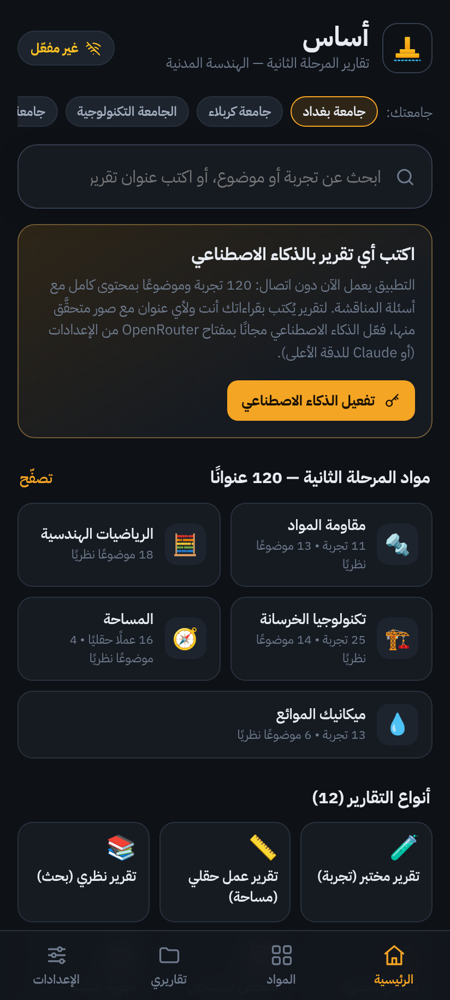
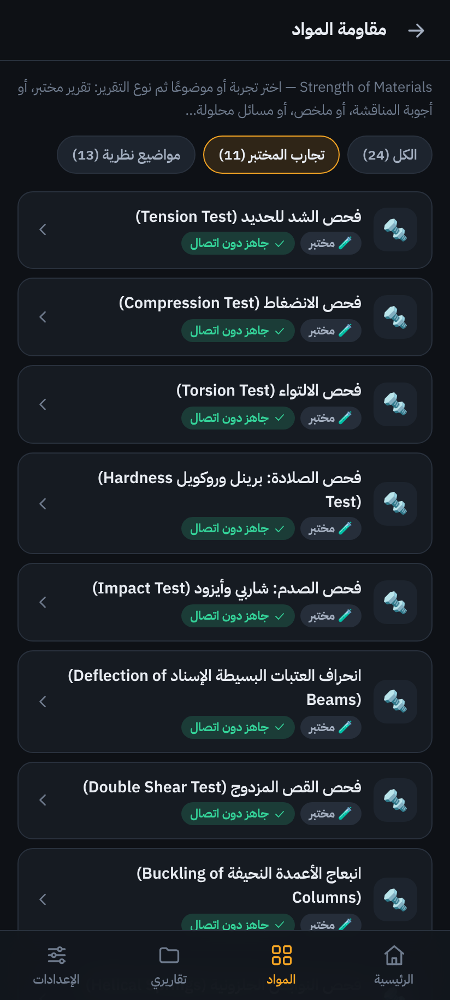
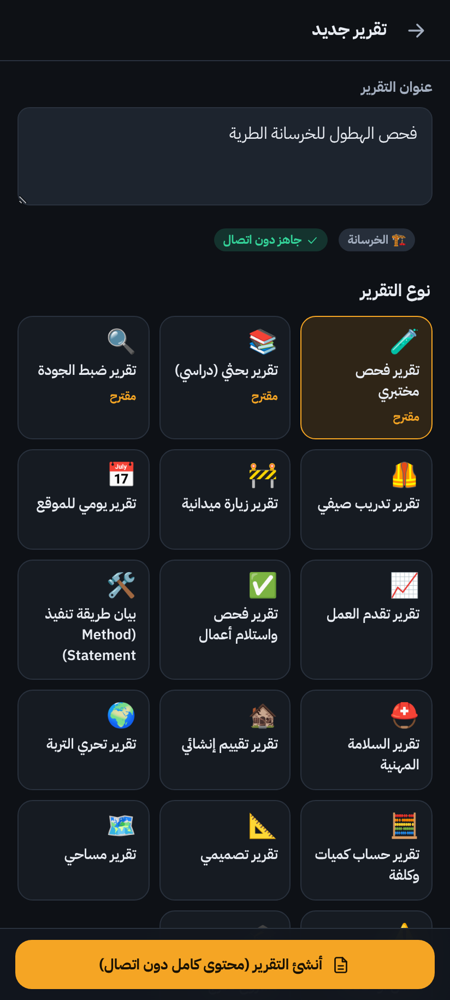
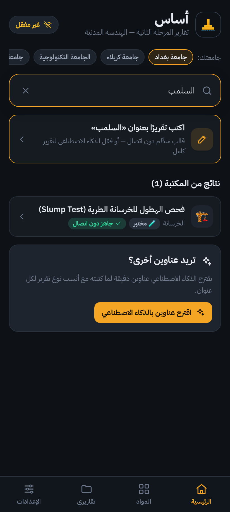
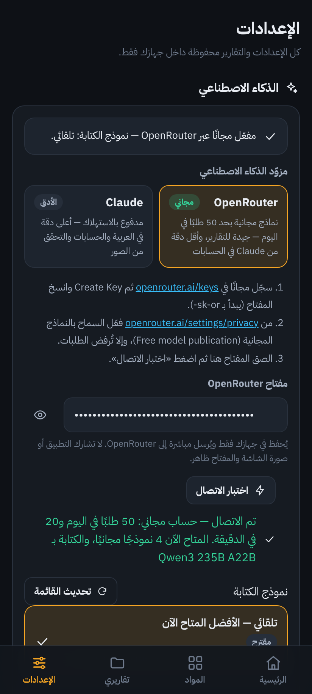
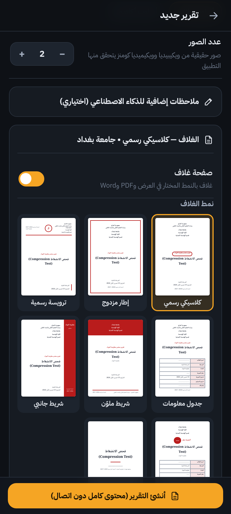
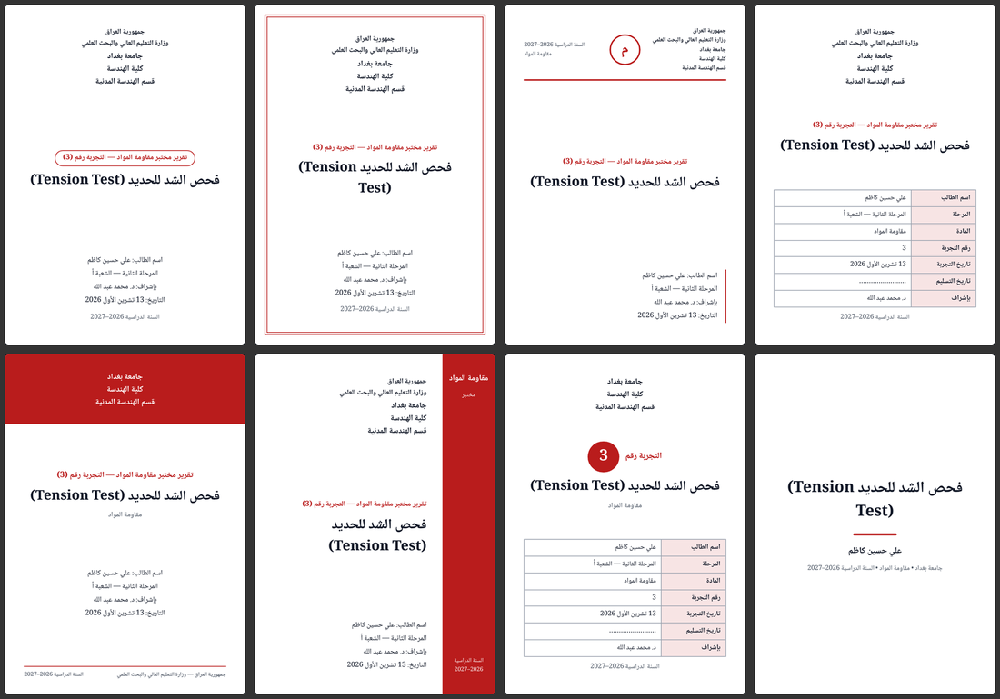

# أساس — تقارير المرحلة الثانية في الهندسة المدنية

تطبيق أندرويد (ويعمل في المتصفح أيضًا) يكتب **التقارير الجامعية لطلبة المرحلة الثانية في قسم الهندسة المدنية بالعربية مع الخطوات**:
تقارير المختبر والأعمال الحقلية والتقارير النظرية والملخصات وأجوبة المناقشة، لمواد
**مقاومة المواد، والرياضيات الهندسية، وتكنولوجيا الخرسانة، والمساحة، وميكانيك الموائع**،
بغلاف بصيغة **جامعة بغداد أو جامعة كربلاء أو الجامعة التكنولوجية** (أو أي جامعة تكتبها).
فيه بحث يفهم الكتابة الدارجة، وكتابة بالذكاء الاصطناعي لأي عنوان بقراءاتك أنت —
**مجانًا عبر OpenRouter** أو بـ Claude للدقة الأعلى — وصور حقيقية من مواقع موثوقة **يتحقّق التطبيق منها قبل وضعها**،
و**٨ أنماط غلاف اختيارية**، وتصدير إلى Word وPDF.

| | | |
|---|---|---|
|  |  |  |
|  |  |  |



---

## ما الذي فيه؟

| الميزة | التفاصيل |
|---|---|
| **المواد الخمس** | مقاومة المواد (١١ تجربة + ١٣ موضوعًا نظريًا)، الرياضيات الهندسية (١٨ موضوعًا)، تكنولوجيا الخرسانة (٢٥ تجربة + ١٤ موضوعًا)، المساحة (١٦ عملًا حقليًا + ٤ مواضيع)، ميكانيك الموائع (١٣ تجربة + ٦ مواضيع) — **١٢٠ عنوانًا** |
| **١٢ نوع تقرير جامعي** | تقرير مختبر، تقرير عمل حقلي، تقرير نظري (بحث)، مسائل محلولة خطوة بخطوة، ملخص للامتحان، أجوبة أسئلة المناقشة، تقرير تطبيقات هندسية، تقرير مقارنة، مشروع المادة، زيارة علمية، سمنار، تدريب صيفي |
| **الخطوات في كل تقرير** | خطوات العمل في المختبر أو الحقل، وطريقة الحل خطوة بخطوة، والحسابات خطوة بخطوة لقراءة واحدة على الأقل |
| **قراءاتك أنت** | في تقارير المختبر والحقل اكتب قراءاتك، فيضعها الذكاء الاصطناعي في الجداول ويحسب منها النتائج؛ وإن لم تكتبها يضع قيمًا نموذجية بين **[ ]** لتستبدلها |
| **غلاف الجامعة (اختياري)** | ٨ أنماط: كلاسيكي رسمي، إطار مزدوج، ترويسة رسمية، جدول معلومات، شريط ملوّن، شريط جانبي، ورقة مختبر، بسيط — بلون المادة، مع شعار الجامعة إن أضفته، ومعاينة حيّة ببيانات تقريرك؛ أو بلا غلاف أصلًا. فيه: جمهورية العراق — وزارة التعليم العالي والبحث العلمي (قابلة للإخفاء)، الجامعة والكلية والقسم، «تقرير مختبر … — التجربة رقم (n)»، الطالب والمرحلة والشعبة والمشرف والتواريخ والسنة الدراسية، ويظهر الغلاف نفسه في التطبيق وPDF وWord |
| **محتوى مُحقَّق** | لكل عنوان: الهدف، النظرية والمعادلات، المواصفة (ASTM / BS / المواصفة العراقية)، الأجهزة، الخطوات، جدول القراءات، **٢٣٣ سؤال مناقشة مع أجوبتها**، و**٨٥ مسألة محلولة** متحقَّق من أرقامها |
| **بحث ذكي بالعربية** | يتسامح مع الأخطاء الإملائية والهمزات والتاء المربوطة، ويفهم الكتابة الدارجة: «تنشن تست»، «كمبريشن»، «سلمب»، «كسر مكعبات»، «فينشوري»، «ليفل»، «توتل ستيشن»، «ترافرس»، «لابلاز»، «ماتركس»، «بكلنك»… ويلتقط المادة ونوع التقرير من الجملة: «ملخص التكامل الثنائي»، «تقرير مختبر الموائع» |
| **لم تجد العنوان؟** | اكتب التقرير بعنوانك مباشرة، أو دع الذكاء الاصطناعي يقترح عناوين دقيقة من مفردات المرحلة الثانية مع أنسب نوع لكل منها |
| **الذكاء الاصطناعي** | **مجانًا عبر OpenRouter** (نماذج مجانية بحد يومي) أو **Claude** (مدفوع، الأدق): يكتب التقرير كاملًا ويظهر النص أثناء الكتابة، ويحرّر أي قسم (إعادة صياغة، توسيع، اختصار، تبسيط، تفصيل الخطوات، إضافة جدول، إضافة المصطلحات الإنجليزية، تصحيح اللغة، أو أي طلب تكتبه) |
| **صور دون أخطاء** | من ويكيبيديا وويكيميديا كومنز وOpenverse، كل صورة تُنزَّل ويُتحقّق من سلامتها، ثم **يراها الذكاء الاصطناعي ويرفض غير المطابقة**، وتُحفظ في جهازك مع مصدرها ورخصتها |
| **يعمل دون إنترنت** | العناوين الـ١٢٠ كلها بمحتوى كامل لكل أنواعها المقترحة، وقالب منظّم بإرشادات لأي عنوان آخر |
| **تصدير** | Word (.docx) باتجاه من اليمين لليسار مع الغلاف والفهرس والصور وأرقام الصفحات، وPDF بالطباعة، ومشاركة النص |

---

## التثبيت على التلفون

نزّل ملف `Asas.apk` من إصدار «أساس — بناء …» الذي **لا** يحمل كلمة «(قديمة)» في صفحة
[**Releases**](https://github.com/notlikeyouthink888/Non/releases) (مُعلَّم Pre-release)،
افتحه من التلفون واسمح بالتثبيت من مصادر غير معروفة. يُبنى الملف تلقائيًا في GitHub Actions مع كل تحديث،
ولكل بناء إصدار جديد برقمه (المستودع لا يسمح بتعديل ملفات إصدار منشور)، وتُعلَّم الإصدارات السابقة «(قديمة)».
إصدارات «أساس» تُنشر تجريبية عمدًا حتى لا تأخذ مكان «أحدث إصدار» الخاص بتطبيق Your World في المستودع نفسه.

أول مرة: اختر جامعتك من أعلى الصفحة الرئيسية، واكتب اسمك وشعبتك ونمط الغلاف (وشعار جامعتك إن أردت) من
**الإعدادات ← بيانات الغلاف الافتراضية**؛ تُحفظ لكل تقاريرك، وتستطيع تغيير الغلاف أو إلغاءه لكل تقرير.

---

## تفعيل الذكاء الاصطناعي

دون أي مفتاح يعمل التطبيق كاملًا للعناوين الـ١٢٠ من قاعدة المعرفة (مع الصور). الذكاء الاصطناعي يلزم
لحساب النتائج من قراءاتك وللعناوين الجديدة واقتراح العناوين والتحقق البصري من الصور، وله طريقان:

### (أ) مجانًا عبر OpenRouter

1. سجّل مجانًا في [openrouter.ai/keys](https://openrouter.ai/keys) ← **Create Key** وانسخ المفتاح (يبدأ بـ `sk-or-`).
2. من [openrouter.ai/settings/privacy](https://openrouter.ai/settings/privacy) فعّل السماح بالنماذج المجانية
   (Free model publication)؛ بدونه ترفض OpenRouter كل الطلبات المجانية، ويخبرك التطبيق بذلك إن نسيته.
3. في التطبيق: **الإعدادات ← الذكاء الاصطناعي ← OpenRouter** ← الصق المفتاح ← «اختبار الاتصال».

- **الحدود المجانية**: 20 طلبًا في الدقيقة و50 طلبًا في اليوم، وتصير 1000 في اليوم بعد شراء رصيد بقيمة 10 دولارات مرة واحدة.
  التقرير الواحد يستهلك من طلبين إلى أربعة (الكتابة، تخطيط الصور، والتحقق منها).
- **اختيار النموذج**: «تلقائي» يختار أفضل نموذج مجاني متاح الآن من قائمة تُجلب حيّة من OpenRouter (لأن النماذج المجانية
  تتغيّر باستمرار)، ويرسل مع كل طلب بديلين: نموذجًا من عائلة أخرى ثم الموجّه المجاني `openrouter/free`. وتستطيع اختيار نموذج بعينه.
- **الدقة**: النماذج المجانية جيدة في الكتابة، لكنها أقل دقة من Claude في الحسابات — راجع الأرقام دائمًا.

### (ب) Claude — الأدق (مدفوع)

1. ادخل [console.anthropic.com](https://console.anthropic.com) ← **API Keys** ← أنشئ مفتاحًا (يبدأ بـ `sk-ant-api`)، واشحن رصيدًا بسيطًا.
2. في التطبيق: **الإعدادات ← الذكاء الاصطناعي ← Claude** ← الصق المفتاح ← «اختبار الاتصال».

المفتاحان يُحفظان في جهازك فقط ويُرسلان مباشرة إلى OpenRouter أو Anthropic. **لا تشارك التطبيق أو صورة الشاشة والمفتاح ظاهر.**
إن أردت أن يستعمل زملاؤك Claude، انشر الخادم الوسيط [`server/worker.js`](server/worker.js) على Cloudflare Workers
(مجاني)، ثم اختر في الإعدادات «خادم وسيط» وضع الرابط ورمز التطبيق؛ يبقى المفتاح على الخادم.

### نماذج Claude والكلفة التقريبية لكل تقرير

| النموذج | متى تختاره | الكلفة التقريبية لتقرير متوسط مع صور |
|---|---|---|
| **Claude Opus 5.5** (الافتراضي) | أعلى دقة للحسابات والتقارير الفنية | نحو 0.15 – 0.30 دولار |
| Claude Sonnet 5.5 | جودة عالية بنصف الكلفة | نحو 0.07 – 0.15 دولار |
| Claude Haiku 5.5 | الأسرع والأرخص بكثير | أقل من سنت واحد |

الأرقام تقديرية وتختلف حسب الطول وعمق التفكير؛ يعرض التطبيق الكلفة الفعلية أسفل كل تقرير، ومجموع الاستهلاك في الإعدادات.
«عمق التفكير» (سريع / متوازن / عميق) يتحكّم بمقدار تفكير النموذج قبل الكتابة؛ «عميق» هو الافتراضي لأن الحسابات تحتاج دقة.

### كيف يحمي التطبيق من الأخطاء؟

- **مع النماذج المجانية**: قائمة النماذج حيّة وبديلان في كل طلب، ومخرجات JSON بمخطط صارم أو بقراءة متسامحة مع محاولة إصلاح،
  وتوحيد عناوين الأقسام إن كتبها النموذج بصيغة مختلفة، وحذف «أفكار» النموذج من النص، ورسائل عربية واضحة عند انتهاء الحصة أو قيود الخصوصية.
- **قاعدة معرفة موثوقة**: معلومات كل عنوان المُحقَّقة (المواصفات، الأجهزة، الخطوات، المعادلات، الحدود، أسئلة المناقشة، الأمثلة المحلولة) تُرسَل للنموذج ليعتمد عليها ولا يخالف أرقامها.
- **قراءاتك كما هي**: يستعمل النموذج قراءاتك دون تعديل ويحسب منها خطوة بخطوة؛ ولا يخترع قراءات: إن لم تكتبها يضع قيمًا نموذجية بين **[ ]** ويصف المثال بأنه توضيحي.
- **تعليمات صارمة**: لا اختلاق لأرقام مواصفات أو مراجع؛ المصادر من الكتب المنهجية المتداولة في أقسام الهندسة المدنية.
- **هيكل ثابت لكل نوع**: الأقسام بالترتيب والعناوين نفسها، ويُنبّهك التطبيق إن نقص قسم.
- **بديل تلقائي**: إن رفضت أنظمة الأمان طلبًا سليمًا خطأً، يعيده الخادم تلقائيًا على نموذج بديل (`fallbacks: "default"`).
- **مع ذلك راجع تقريرك دائمًا** قبل تسليمه، خصوصًا الأرقام، وطابقه مع دليل المختبر وما يطلبه أستاذ المادة.

---

## الصور «دون أخطاء» — ماذا يحدث فعلًا؟

1. يخطّط الذكاء الاصطناعي الصور المناسبة لكل قسم (تعليق عربي + عبارات بحث إنجليزية + ما يجب أن يظهر في الصورة).
2. يبحث التطبيق في ويكيبيديا (الصورة الرئيسية لأقرب المقالات) وويكيميديا كومنز، ثم Openverse احتياطًا.
3. يستبعد الشعارات والخرائط والأيقونات والصور الصغيرة أو الغريبة الأبعاد.
4. **يُنزّل كل مرشح فعلًا ويفكّه** — أي رابط معطوب أو ملف تالف يُحذف قبل أن تراه.
5. يرسل المرشحين السليمين للذكاء الاصطناعي ليختار المطابق للموضوع فعلًا، ويرفض الكل إن لم يطابق شيء — **لا صورة أفضل من صورة خاطئة**.
6. تُحفظ الصورة المختارة داخل جهازك مع مصدرها ومؤلفها ورخصتها، فلا تنكسر لاحقًا حتى دون إنترنت.

يمكنك دائمًا استبدال أي صورة من المرشحين، أو البحث يدويًا، أو اختيار صورة من جهازك (صور تجربتك في المختبر مثلًا).

---

## التطوير

```bash
cd asas              # التطبيق كله داخل هذا المجلد
npm install
npm run dev          # http://localhost:5173
npm run check        # فحص آلي شامل بمحاكاة Claude وOpenRouter ومواقع الصور (64 فحصًا) + فحص ملفات Word الناتجة
npm run check -- --shots   # مع لقطات في docs/shots
npm run icons        # توليد أيقونات أندرويد وشاشة البداية من الشعار
npm run android:sync # بناء + مزامنة مشروع أندرويد
npm run android:apk  # بناء APK محليًا (يحتاج Android SDK وJDK 21)
```

الفحص الآلي يشغّل التطبيق في متصفح حقيقي ويجرّب: المواد الخمس وأنواع التقارير والجامعة الافتراضية،
أنماط الغلاف الثمانية والتقرير بلا غلاف (في العرض وWord: قسم مستقل، إطار صفحة حقيقي، جدول المعلومات)،
مفتاحًا ملصوقًا دون حدث input كما يحدث في بعض لوحات مفاتيح أندرويد، وOpenRouter كاملًا (قائمة النماذج الحيّة،
خطأ الخصوصية، المفتاح الخاطئ، بث يحوي تعليقات وأفكارًا وعناوين بصيغ مختلفة، JSON داخل شرح، تحقق بصري بدفعات)،
البحث بالكتابة الدارجة، تصفح المادة وتصفية التجارب، تقرير مختبر دون اتصال (الأقسام، الخطوات، المعادلات،
أسئلة المناقشة، الغلاف)، مفتاح خاطئ، اختبار الاتصال، اقتراح العناوين، كتابة تقرير متدفق، التحقق البصري
من الصور (مع رفض صورة غير مطابقة)، تحرير قسم، استبدال صورة، تصدير Word وفحص الملف (الاتجاه، الصور، الجداول، الغلاف)،
وصول قراءات الطالب إلى الذكاء الاصطناعي، والمكتبة، ويتحقق أن كل طلب إلى Claude سليم الشكل
(النموذج، التفكير التكيّفي، الجهد، البديل التلقائي، التخزين المؤقت).

### بنية المشروع

```
src/
  main.js · app.js         نقطة الدخول والموجّه وشريط التنقل
  core/                    التخزين (localStorage + IndexedDB)، البحث العربي، الواجهة، الجسر نحو أندرويد
  data/
    types.js               ١٢ نوع تقرير جامعي وهيكل أقسام كل نوع
    categories.js          المواد الخمس للمرحلة الثانية
    universities.js        جامعة بغداد، جامعة كربلاء، الجامعة التكنولوجية
    topics.js              ١٢٠ عنوانًا (تجارب مختبر، أعمال حقلية، مواضيع نظرية) مع الكتابة الدارجة
    kb/                    قاعدة المعرفة: محتوى كامل للعناوين الـ١٢٠
  search/                  محرك البحث (مطابقة تقريبية + وزن الكلمات النادرة + اكتشاف المادة والنوع)
  ai/                      client (الواجهة الموحّدة) · claude · openrouter · prompts
  images/                  مصادر الصور وخط التحقق
  report/                  محلّل النص، المؤلّف دون اتصال، خط الإنتاج، العرض، أنماط الغلاف (covers)، أوراق التحرير
  export/                  Word (مع cover-docx لأغلفة Word) ونص عادي
  screens/                 الرئيسية، المواد، الإنشاء، التقرير، تقاريري، الإعدادات
android/                   مشروع Capacitor + إضافة الطباعة PrinterPlugin
server/worker.js           خادم وسيط اختياري يحفظ المفتاح بعيدًا عن الأجهزة
tools/                     الفحص الآلي ومحاكيات الشبكة وتوليد الأيقونات
```

التفاصيل المعمارية في [`ARCHITECTURE.md`](ARCHITECTURE.md).

---

## الخصوصية

كل التقارير والصور والإعدادات محفوظة داخل جهازك (IndexedDB وlocalStorage). لا حساب ولا خادم للتطبيق.
الاتصال الخارجي الوحيد: OpenRouter أو Anthropic (عند استعمال الذكاء الاصطناعي) ومواقع الصور المفتوحة (عند جلب الصور).
يمكنك تصدير نسخة احتياطية كاملة أو حذف كل شيء من الإعدادات.

---

«أساس» كله داخل مجلد `asas/` ويُبنى بسير عمل خاص به (`.github/workflows/asas-apk.yml`)،
مستقلًا تمامًا عن تطبيق Your World الموجود في جذر المستودع.
