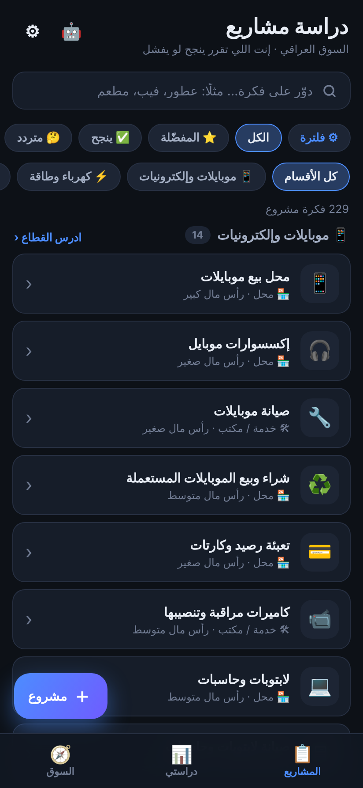
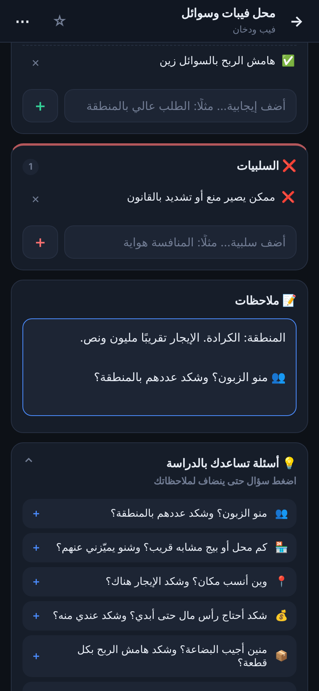
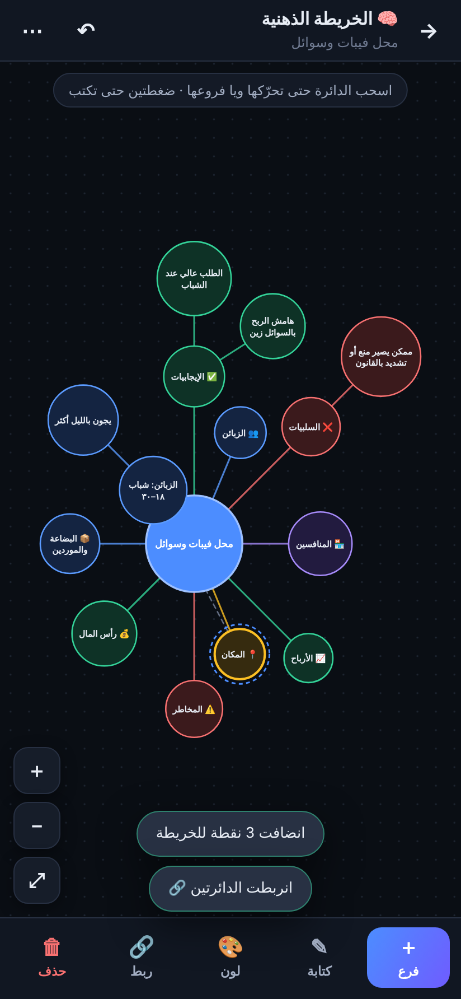
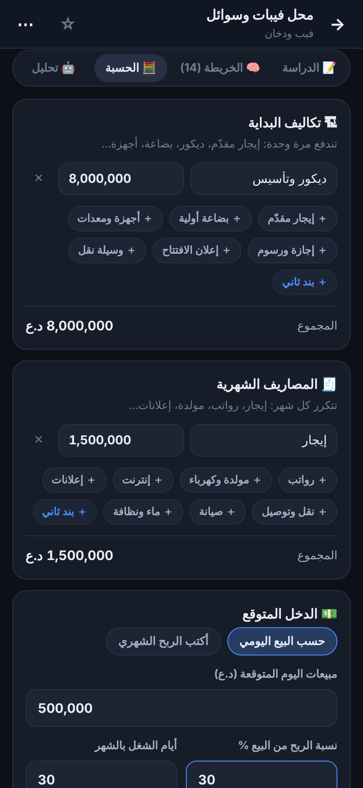
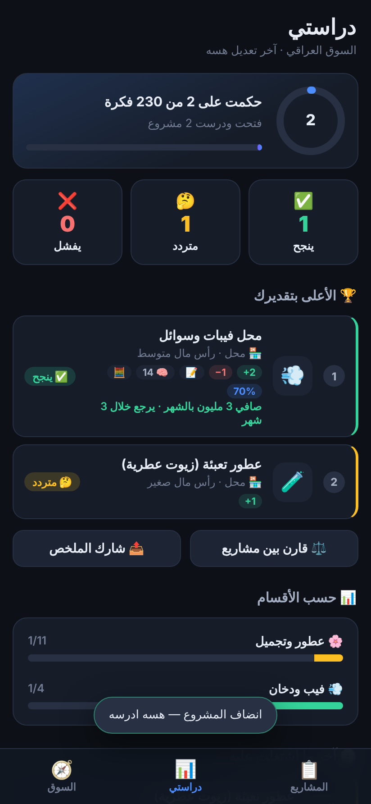
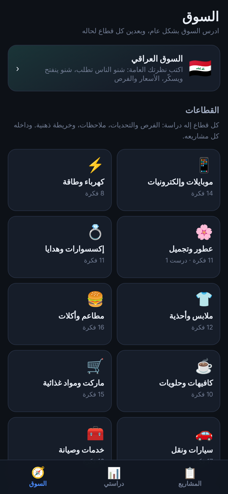
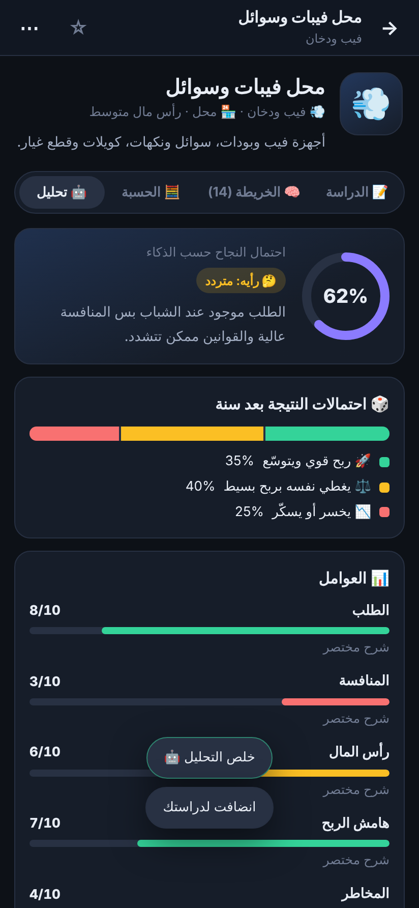
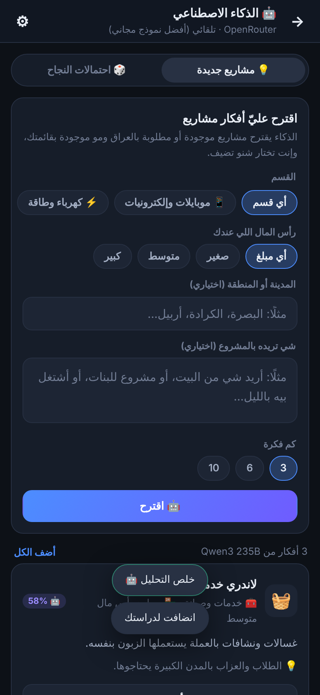
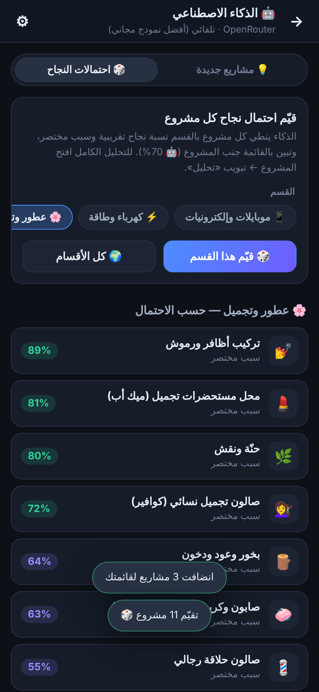

# دراسة مشاريع — السوق العراقي

تطبيق أندرويد مستقل لدراسة أفكار المشاريع بالسوق العراقي.
بيه قاعدة فيها **229 فكرة مشروع** موجودة بالسوق، موزّعة على **20 قسم**
(محلات، بيجات أونلاين، خدمات، أكلات، معامل، زراعة، سياحة وزيارات…)،
و**إنت اللي تدرس وتقرر**: ينجح لو يفشل.

> التطبيق بمجلّده الخاص `mashari/`، وما يلمس «Your World» ولا الألعاب القديمة بالمستودع.
> ينصب على التلفون كتطبيق ثاني جنبهم.

## التنزيل

ملف التثبيت ينبني تلقائيًا على GitHub، وكل بناء إله إصدار جديد باسم «دراسة مشاريع — بناء N»
(السابقة تتعلّم «(قديمة)»):
**[كل نسخ التطبيق](https://github.com/notlikeyouthink888/Non/releases?q=mashari)**
← افتح أحدث بناء ← نزّل `DirasatMashari.apk` من متصفّح التلفون ← افتحه ← اسمح بالتثبيت من مصادر غير معروفة ← ثبّت.
النسخ الجديدة تنصب فوق القديمة، ودراستك تبقى.

## شنو بيه

| | |
|---|---|
| ✅ 🤔 ❌ | حكمك على كل مشروع: ينجح، متردد، أو يفشل — ونسبة النجاح بتقديرك |
| ➕ ➖ | الإيجابيات والسلبيات تكتبها بنفسك (القاعدة ما تحكم بدالك) |
| 📝 | ملاحظات حرّة، وأسئلة تساعدك بالدراسة تنضاف بضغطة |
| 🧠 | **خريطة ذهنية**: دوائر متصلة تضيفها، تربطها ببعض، تلوّنها، وتحرّكها بإصبعك |
| 🧮 | حسبة: تكاليف البداية، المصاريف الشهرية، الدخل المتوقع ← صافي الربح ومتى يرجع رأس المال |
| ⚖️ | مقارنة لحد ٤ مشاريع جنب بعض |
| 🧭 | دراسة السوق العام، وكل قطاع (عطور، إكسسوارات، أكلات…) لحاله |
| ＋ | تضيف أفكارك وأقسامك، تعدّل أي فكرة، وتخفي اللي ما يهمك |
| 📤 | تشارك دراسة أي مشروع كنص (واتساب، تلگرام)، أو ملخص دراستك كلها |
| 🤖 | **ذكاء اصطناعي (OpenRouter)**: يحلل احتمالات نجاح أي مشروع، يقيّم أقسام كاملة، ويقترح مشاريع جديدة |

كل شي يشتغل **بدون إنترنت** وبدون حساب (عدا الذكاء الاصطناعي)، والدراسة تنحفظ داخل التلفون.

## الخريطة الذهنية

- **＋ دائرة** تضيف فرع حول المشروع، و**＋ فرع** تضيف تحت الدائرة المختارة.
- ضغطة تختار الدائرة، ضغطتين تكتب بيها، وضغطة طويلة تفتح قائمتها.
- اسحب الدائرة تتحرّك ويا فروعها، واسحب الفراغ تتحرّك الخريطة، وإصبعين للتكبير.
- **🔗 ربط** يوصل أي دائرتين ببعض بخط منقّط، و**↶** يتراجع عن آخر خطوة.
- من **⋯**: فروع جاهزة (الزبائن، المنافسين، المكان، رأس المال…)، نقل الإيجابيات
  والسلبيات كدوائر خضراء وحمراء، ترتيب تلقائي، ومشاركة الخريطة كنص.

## الذكاء الاصطناعي (OpenRouter)

يحتاج مفتاح **مجاني** من OpenRouter وإنترنت (باقي التطبيق يشتغل بدون إنترنت):
سجّل بـ [openrouter.ai](https://openrouter.ai) ← [openrouter.ai/keys](https://openrouter.ai/keys) ← Create Key،
وفعّل النماذج المجانية من [إعدادات الخصوصية](https://openrouter.ai/settings/privacy)،
وبعدين بالتطبيق: ⚙ الإعدادات ← الذكاء الاصطناعي ← الصق المفتاح ← «احفظ وجرّب».

- **تحليل مشروع** (تبويب «🤖 تحليل» بصفحة المشروع): احتمال النجاح، احتمالات النتيجة بعد سنة
  (ربح قوي / يغطي نفسه / خسارة)، تقييم ستة عوامل (الطلب، المنافسة، رأس المال، هامش الربح، المخاطر،
  سهولة التشغيل)، تقدير تكاليف البداية والربح بالشهر، مخاطر ونصائح وأشياء تتأكد منها بالسوق.
  ياخذ دراستك بعين الاعتبار، وكل إيجابية أو سلبية يقترحها تضيفها لدراستك بضغطة إذا تقتنع بيها.
- **احتمالات النجاح** (زر 🤖 بالشاشة الرئيسية): يقيّم كل مشاريع قسم بنسبة وسبب مختصر، وتبين
  النسبة جنب كل مشروع بالقائمة (🤖 70%)، وتگدر ترتّب القائمة حسبها.
- **مشاريع جديدة**: تختار القسم والميزانية والمدينة، ويقترح أفكار مو موجودة بقائمتك، وتضيف اللي يعجبك.

المفتاح ينحفظ بتلفونك بس وما يطلع ويا النسخة الاحتياطية. الحساب المجاني: 20 طلب بالدقيقة و50 باليوم.
يستعمل أفضل نموذج مجاني متاح، وإذا توقّف يتحوّل تلقائيًا لبديل (`openrouter/free`).
**الحكم الأخير يبقى إلك** — رأي الذكاء تقديري وممكن يغلط.

## بياناتك

كل الدراسة بـ `localStorage` داخل التلفون. من ⚙ الإعدادات:
**💾 احفظ نسخة** (تختار مكان الملف)، **📤 أرسل النسخة** (لنفسك على تلگرام مثلًا)،
و**📥 رجّع نسخة** — حتى ما تضيع دراستك إذا بدّلت التلفون.

## للمطوّر

```bash
cd mashari
npm install
npm run dev            # معاينة بالمتصفح: http://localhost:5174
npm run check          # بناء + فحص آلي لكل المسارات بمتصفح حقيقي (--shots للّقطات)
npm run android:sync   # بناء + مزامنة مشروع أندرويد
node tools/icons.mjs   # توليد أيقونات أندرويد من الرسم
```

بناء APK يصير تلقائيًا بـ GitHub Actions (`.github/workflows/build-mashari-apk.yml`)
عند أي تغيير داخل `mashari/`.

```
mashari/
  src/
    data/projects.js   ٢٢٩ فكرة بوصف محايد (بلا إيجابيات وسلبيات — هذي شغلك)
    data/guide.js      أسئلة الدراسة، بنود الحسبة، وفروع الخريطة الجاهزة
    model.js           المشاريع، الدراسات، الفلترة، وحساب الأرباح
    ai/                اتصال OpenRouter (نماذج مجانية وبدائل) ومهام التحليل والتقييم والاقتراح
    views/             القائمة، صفحة الدراسة، الحسبة، دراستي، السوق، المقارنة، الإعدادات
    mindmap/           بيانات الخريطة، الرسم بـ SVG، ومحرّر اللمس
    core/              التخزين، أدوات DOM، الأوراق والصفحات وزر الرجوع، جسر أندرويد
  android/             مشروع Capacitor (com.mashari.app) + FilesPlugin.java للحفظ والمشاركة
  android/keystore/    مفتاح توقيع ثابت (للتثبيت الشخصي) حتى كل نسخة تنصب فوق اللي قبلها
  tools/               الفحص الآلي وتوليد الأيقونات
```

## لقطات

| القائمة | الدراسة | الخريطة الذهنية |
|---|---|---|
|  |  |  |

| الحسبة | دراستي | السوق |
|---|---|---|
|  |  |  |

| تحليل الذكاء | مشاريع جديدة | احتمالات قسم |
|---|---|---|
|  |  |  |
