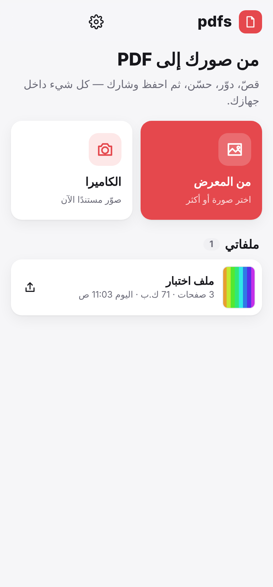
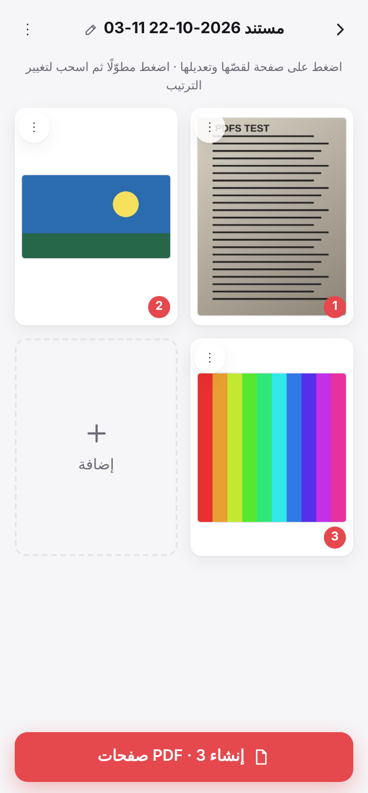
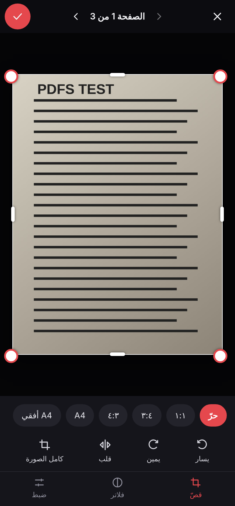
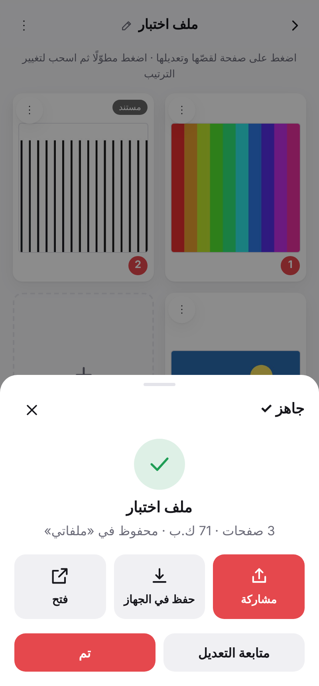

# pdfs

تطبيق أندرويد يحوّل صورك إلى ملفات **PDF** — يعمل دون إنترنت، وملفاتك لا تغادر جهازك إلا حين تشاركها أنت.

<p align="center">
  
  
  
  
</p>

## الميزات

| | |
|---|---|
| 🖼 **الإضافة** | من المعرض (عدّة صور مرّة واحدة)، من الكاميرا، أو **«مشاركة ← pdfs»** من أي تطبيق آخر |
| ✂️ **القص** | حرّ أو بنسب جاهزة (١:١، ٣:٤، ٤:٣، A4، A4 أفقي، ١٦:٩) بمقابض سحب وشبكة أثلاث |
| 🔄 **التدوير والقلب** | تدوير يمين/يسار وقلب أفقي — لصفحة واحدة أو لكل الصفحات |
| 🎨 **الفلاتر** | الأصل، **مستند** (يبيّض الورق ويزيل الظلال)، أبيض وأسود، رمادي، زاهٍ + سطوع وتباين |
| 📑 **ترتيب الصفحات** | اضغط مطوّلًا واسحب، أو انقل إلى البداية/النهاية، تكرار، حذف، عكس الترتيب |
| ⚙️ **إعدادات الملف** | حجم الصفحة (A4، Letter، A5، Legal، مطابق للصورة)، الاتجاه، الهوامش، الجودة/الحجم، ترقيم الصفحات |
| 💾 **الحفظ** | كل ملف يُحفظ في «ملفاتي» داخل التطبيق، و«حفظ في الجهاز» ينسخه إلى `التنزيلات/pdfs` |
| 📤 **المشاركة** | واتساب، تيليجرام، البريد… أي تطبيق في جهازك، أو «فتح» بعارض PDF |
| ✏️ **إعادة التعديل** | افتح أي ملف محفوظ وعدّل صفحاته ثم أعد إنشاءه |
| 📝 **مسودة تلقائية** | عملك يُحفظ أولًا بأول، فلا يضيع إن أُغلق التطبيق |
| 🌗 **المظهر** | فاتح، داكن، أو حسب الجهاز — واجهة عربية كاملة |

## التنزيل

كل تعديل على مجلّد `pdfs/` يبني ملف APK تلقائيًا عبر GitHub Actions
(`.github/workflows/build-pdfs-apk.yml`) وينشره في إصدار **`pdfs-latest`** ضمن صفحة Releases.

## التطوير

```bash
cd pdfs
npm install
npm run dev          # معاينة في المتصفّح: http://localhost:5174
npm run check        # فحص آلي كامل: استيراد، قصّ، فلتر، إنشاء PDF والتحقّق منه
npm run android:sync # بناء + مزامنة مشروع أندرويد
cd android && ./gradlew assembleDebug   # يحتاج JDK 21 وAndroid SDK 35
```

## البنية

```
src/
  main.js          الإقلاع + استقبال الصور (مشاركة، سحب وإفلات، لصق)
  app.js           مكدّس الشاشات وزرّ الرجوع
  core/
    pdf.js         كاتب PDF بلا مكتبات (JPEG مضمّن مباشرة، عناوين عربية، ترقيم)
    image.js       الاستيراد والتدوير والقلب والقص والفلاتر — غير مُتلِفة
    project.js     المسودة، المصغّرات، والتصدير
    db.js          IndexedDB: الصور والملفات وبياناتها
    native.js      المشاركة والحفظ والفتح (أندرويد) مع بدائل ويب
    ui.js dom.js settings.js fmt.js
  views/           home · project · editor · export · docs · settings · pick
android/app/src/main/java/com/pdfs/app/
  MainActivity.java
  PdfsPlugin.java  الحفظ في التنزيلات (MediaStore)، الفتح بتطبيق آخر، استقبال الصور المشارَكة
```

## الأذونات

| الإذن | السبب |
|---|---|
| `INTERNET` | خادم Capacitor المحلي داخل الجهاز فقط — لا اتصال بأي خدمة خارجية |
| `WRITE_EXTERNAL_STORAGE` (أندرويد 9 وما قبله) | الحفظ في «التنزيلات»؛ الإصدارات الأحدث لا تحتاج أي إذن |

الكاميرا تُفتح عبر تطبيق الكاميرا في جهازك، فلا يحتاج التطبيق إذن الكاميرا.
